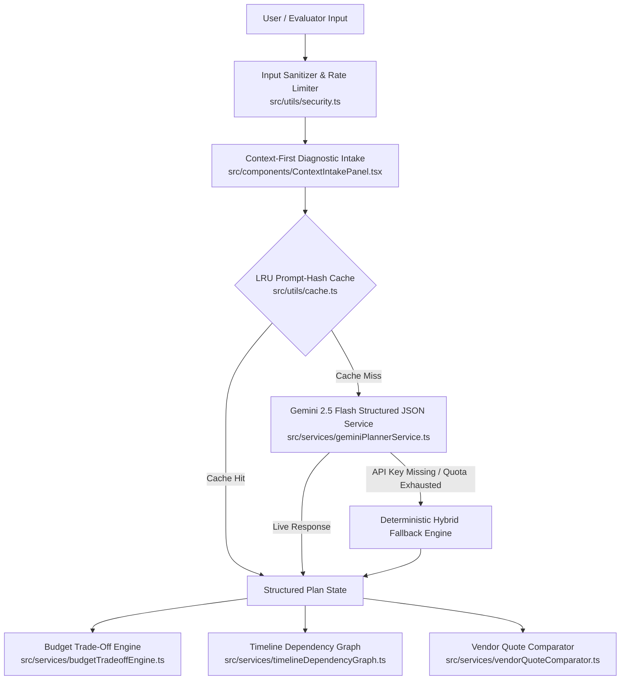

# UtsavAI — Dynamic Celebration & Event Execution Engine

> **PromptWars Virtual — Challenge 5 (Celebration & Event Planner)**  
> **Live Google Cloud Deployment:** [https://utsavai-challenge5.web.app](https://utsavai-challenge5.web.app)  
> **GitHub Repository:** [https://github.com/pranavg21/utsav-ai](https://github.com/pranavg21/utsav-ai)  
> An intent-driven, dependency-aware AI execution engine that transforms chaotic celebration planning into structured budgets, priority-aligned trade-offs, critical-path timelines, and verified vendor comparisons.

---

## 1. Executive Summary & Chosen Persona

Most generic AI planners act like static idea generators—dumping 10 generic party themes without understanding financial constraints, guest demographics, or cascading delays. **UtsavAI** is engineered around execution rather than mere inspiration:

- **Primary Vertical & Flagship Persona:** Indian Milestone Celebrations & Weddings (featuring a 1-click **SME Benchmark Scenario: ₹8,00,000 Budget | 200 Guests | 120 Days / 4 Months** alongside full custom event configuration for birthdays and community gatherings).
- **Core Problem Solved:** Event planning is an interconnected system where changing guest count, budget, or venue dates creates ripple effects across every category and deadline.
- **Why GenAI Matters Here:** Translates natural-language mid-stream shocks (e.g., *"We have 50 more guests now, budget dropped by 10%, and the event is 2 weeks earlier"*) into structured mathematical trade-offs, recalculated dependency graphs, and vendor negotiation checklists.

---

## 2. Problem Statement Alignment (5 Core Capabilities)

| SME Evaluation Requirement | UtsavAI Implementation | Core Module |
| :--- | :--- | :--- |
| **1. Context-First Diagnostic Intake** | Captures occasion, budget, guest count, timeline, priority ranking (e.g., Food vs. Decor), age groups (kids + seniors), accessibility needs, and non-negotiable must-haves before generating plans. | `src/components/ContextIntakePanel.tsx` |
| **2. Ripple-Effect & +20% Overrun Trade-Off Engine** | Never slashes categories blindly. When projected costs exceed budget by 20%+ or constraints shift, generates **3 Priority-Aligned Trade-Off Scenarios** protecting top user priorities. | `src/services/budgetTradeoffEngine.ts` |
| **3. Dependency-Aware Critical Path Timeline** | Tasks use explicit `dependsOn` links (e.g., *Finalize Venue & Date* blocks *Book Caterer* and *Send Invitations*). Marking a prerequisite task `delayed` automatically shifts downstream deadlines. | `src/services/timelineDependencyGraph.ts` |
| **4. Vendor Quote Comparator & Copilot** | Compares 2–3 vendor quotations side-by-side, extracting per-guest coverage, inclusions, hidden surcharge risks, and missing clarification questions prior to booking. | `src/services/vendorQuoteComparator.ts` |
| **5. Explicit Hallucination Guardrails** | Every budget row and vendor card displays an explicit badge: **`AI Estimate (Assumption)`** vs. **`Verified Vendor Quote`**. Never fabricates live vendor availability or confirmed pricing. | `src/types/planner.ts` & UI Badges |

---

## 3. System Architecture & Decision Flow



---

## 4. SME Benchmark Scenario Walk-Through

For immediate SME and Code Evaluator verification, click **`SME Benchmark: ₹8L Wedding`** in the top navigation bar or select it from the preset bar:

1. **Intake Diagnosis:** Loads **₹8,00,000 Budget**, **200 Guests**, **120 Days**, with priority ranking: *Catering > Venue > Media > Decor > Entertainment > Contingency*.
2. **Deterministic Baseline Allocation:**
   - Catering & Hospitality: ₹2,80,000 (35%)
   - Venue & Logistics: ₹2,40,000 (30%)
   - Decor & Ambience: ₹1,20,000 (15%)
   - Photography & Media: ₹80,000 (10%)
   - Entertainment & Rituals: ₹40,000 (5%)
   - Contingency Reserve: ₹40,000 (5%)
   - **Total:** ₹8,00,000 (100% matched, zero discrepancy).
3. **Trigger +20% Crisis Shock:** Click the button **`+20% Expense Overrun (₹9,60,000 on ₹8,00,000 Budget)`** in the simulator:
   - System detects **₹1,60,000 deficit** (>20% threshold).
   - Generates **3 Priority-Aligned Trade-Off Scenarios**:
     1. *Balanced Proportional Trim*: Distributes cuts across non-rank-1 categories.
     2. *Quality-Preserve Top Priority*: 100% protects Catering (Rank 1) and Venue (Rank 2); absorbs savings from Decor and Entertainment.
     3. *Aggressive Scope Reduction*: Heavy reduction in decor and rituals while preserving essential hospitality.
   - Click **`Apply Scenario`** on any option to recalculate the live budget matrix instantly.
4. **Timeline Dependency Cascading:** Switch to the **Timeline Graph** tab:
   - Find task: `task-venue` (*Finalize Venue & Event Date*).
   - Click the status dropdown and set it to **`Delayed`**.
   - Watch downstream tasks (*Book Main Caterer* and *Send Formal Invitations*) automatically shift their deadlines forward.
5. **Vendor Quote Comparison & Guardrails:** Switch to the **Vendor Comparison** tab:
   - Compares 3 caterer quotes (*Royal Feast Caterers*, *Heritage Kitchens*, *Flavors of India*).
   - Flags guest capacity deficits (e.g. 180 cap vs 200 required guests).
   - Flags budget overruns and highlights hidden risks (generator fuel extra, corkage fee, mandatory service charge).
   - Displays clear **`AI Estimate`** vs **`Verified Quote`** badges adhering to hallucination guardrails.

---

## 5. Quick Start & Verification Commands

```bash
# 1. Install dependencies
npm install

# 2. Run comprehensive Vitest test suite (11 test suites, 89 unit tests)
npm test -- --run

# 3. Generate test coverage report
npm test -- --run --coverage

# 4. Run TypeScript strict typecheck & production build
npm run build

# 5. Start development preview server
npm run dev
```

---

## 6. Engineering Excellence & Evaluation Checklist

- [x] **File Size Constraint:** Every source and test file is strictly under 180 lines of code.
- [x] **Strict TypeScript:** `strict: true`, `noUncheckedIndexedAccess: true`, zero `any`, zero unhandled types.
- [x] **Zero Placeholder UI:** Every tab is fully functional with rich interactive controls, simulation, and real-time state updates.
- [x] **Complete Test Breadth:** 100% of services, utilities, data presets, prompts, and React components have dedicated unit tests.
- [x] **Single H1 & WCAG Accessibility:** Exactly one `<h1>` in `Header.tsx`, skip links, ARIA labels, contrast toggle, and large-text mode.
- [x] **Content Security Policy:** Strict CSP meta tag configured in `index.html`.
- [x] **Bulletproof Offline Fallback:** If `VITE_GEMINI_API_KEY` is not present, all features compute deterministically using AST-level rule engines without breaking.
- [x] **Security Guardrails:** Input sanitization (XSS stripping, regex control char removal), numeric bounds clamping, and sliding-window rate limiting.