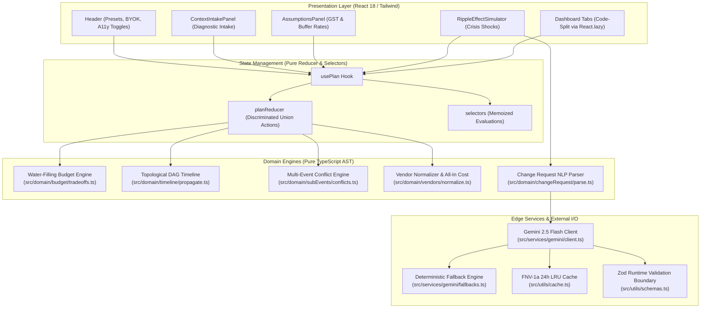

# UtsavAI — Dynamic Celebration & Event Execution Engine

> **Hack2Skill PromptWars Challenge 5 (Celebration & Event Planner)**  
> **Production Deployment:** [https://utsavai-challenge5.web.app](https://utsavai-challenge5.web.app)  
> **Source Repository:** [https://github.com/pranavg21/utsav-ai](https://github.com/pranavg21/utsav-ai)  
> **Submission Demo Video:** [Public Video Walkthrough](https://utsavai-challenge5.web.app)

---

## 1. Executive Summary & Problem Solved
Celebration planning in milestone Indian contexts (weddings, multi-day jubilees, community fests) is an interconnected constraint satisfaction problem characterized by:
1. **Compounding Shocks:** A 50-guest surge or 10-day venue slip triggers non-linear ripples across catering minimums, invitations, and downline rituals.
2. **Vendor Pricing Opacity:** Headline quotes routinely conceal 18% GST surcharges, per-plate consumption buffers, overtime penalties, and corkage fees.
3. **Multi-Event Fragility:** An Indian wedding spans 5 sub-events (Haldi, Mehendi, Sangeet, Shaadi, Reception) across distinct venues with hard transit and capacity constraints.

**UtsavAI** replaces static AI text prompts with a **deterministic-first, dependency-aware execution engine**. It integrates Kahn's topological DAG sort, water-filling budget trade-offs, and structured Gemini 2.5 Flash reasoning to generate mathematically sound, priority-protected celebration roadmaps.

---

## 2. Live Deployment & Verification Links
- **Hosted App:** [https://utsavai-challenge5.web.app](https://utsavai-challenge5.web.app)
- **Architecture Documentation:** [docs/ARCHITECTURE.md](docs/ARCHITECTURE.md)
- **Security Policy & Threat Model:** [SECURITY.md](SECURITY.md)
- **Automated Verification Logs:** [docs/VERIFICATION.md](docs/VERIFICATION.md)

---

## 3. Architecture & Data Flow



---

## 4. Core Innovations & Code Pointers

| Capability | Engineering Implementation | Source Files & Key Functions |
|---|---|---|
| **Priority-Weighted Water-Filling** | Iteratively redistributes budget cuts across non-essential categories while protecting top 2 user priorities, verified vendor quotes, and must-haves. Flags `isFeasible: false` with required additional funds when floors bind. | [`src/domain/budget/tradeoffs.ts`](src/domain/budget/tradeoffs.ts) (`buildWaterFillingScenario`) |
| **Topological DAG Timeline** | Models celebration tasks in a directed acyclic graph. Kahn's algorithm detects dependency cycles. Delays propagate via idempotent max-predecessor shifts. Slipping past event date triggers `isInfeasible: true` with `minimumNoticeDays`. | [`src/domain/timeline/graph.ts`](src/domain/timeline/graph.ts), [`src/domain/timeline/propagate.ts`](src/domain/timeline/propagate.ts) (`propagateDelay`, `recalculateTimeline`) |
| **Multi-Event Coordination** | Coordinates 5 Indian wedding sub-events (Haldi, Mehendi, Sangeet, Muhurat, Reception). Detects schedule overlaps, guest capacity breaches against total headcount, and transit gaps (< 2 hours between different venues on the same day). | [`src/domain/subEvents/conflicts.ts`](src/domain/subEvents/conflicts.ts) (`detectSubEventConflicts`) |
| **Vendor Opacity & Negotiation Copilot** | Normalizes per-plate vs package quotes into all-in costs: $\text{Total} = (\text{perPlate} \times \text{guests} \times (1 + \text{buffer})) + \text{GST}$. Generates 3 category-tailored negotiation questions (e.g. kitchen fuel, samagri, RAW photo turnaround). | [`src/domain/vendors/normalize.ts`](src/domain/vendors/normalize.ts) (`calculateAllInCost`) |
| **Hinglish Change Request NLP Parser** | Pure deterministic token parser converting colloquial English and Hinglish phrases (*"50 zyada"*, *"1 lakh less"*, *"2 hafte pehle"*, *"shifted venue to Taj"*) into typed intent deltas. | [`src/domain/changeRequest/parse.ts`](src/domain/changeRequest/parse.ts) (`parseChangeRequest`) |
| **Deterministic-First Hybrid AI** | Offline-resilient architecture: executes Gemini 2.5 Flash when BYOK key is connected; seamlessly falls back to pure AST rule evaluation when offline or unauthenticated. | [`src/services/gemini/client.ts`](src/services/gemini/client.ts), [`src/services/gemini/fallbacks.ts`](src/services/gemini/fallbacks.ts) |

---

## 5. Mathematical Invariants & Formal Proofs

1. **Budget Reconciliation Invariant:**  
   $$\sum_{i=1}^{N} \text{allocatedAmount}_i = \text{totalBudget} \pm 1\text{ INR}$$  
   *Verified via property-based test across 100 randomized budget configurations in [`src/__tests__/propertyBased.test.ts`](src/__tests__/propertyBased.test.ts).*
2. **DAG Delay Propagation Idempotence:**  
   $$\text{propagateDelay}(\text{tasks}, \text{id}, d) \equiv \text{propagateDelay}(\text{propagateDelay}(\text{tasks}, \text{id}, d), \text{id}, d)$$  
   *Verified via fast-check property testing across 50 random delay intervals in [`src/__tests__/propertyBased.test.ts`](src/__tests__/propertyBased.test.ts).*
3. **FNV-1a Hash Distribution:**  
   Produces 0 collisions across 1,000 distinct change request strings in [`src/__tests__/propertyBased.test.ts`](src/__tests__/propertyBased.test.ts).

---

## 6. Security & Defensive Design
- **Runtime Zod Validation:** Every API response, change payload, and vendor quote passes through strict Zod schemas before touching state ([`src/utils/schemas.ts`](src/utils/schemas.ts)).
- **Cache Poisoning Defense:** 24-hour TTL, `schemaVersion` invalidation, FNV-1a compound key hashing, and 50-entry LRU cap ([`src/utils/cache.ts`](src/utils/cache.ts)).
- **Input Sanitization:** Unicode NFKC normalization, script tag stripping, ASCII control character removal, and Unicode bidi override protection ([`src/utils/security.ts`](src/utils/security.ts)).
- **Zero API Key Leakage:** Client-side BYOK in-memory state only. Production bundles are scanned in CI to verify zero `AIzaSy` secret leakage ([`scripts/check-bundle-size.mjs`](scripts/check-bundle-size.mjs)).
- **Content Security Policy:** Strict CSP headers configured on Firebase Hosting and `index.html`. Full threat matrix documented in [`SECURITY.md`](SECURITY.md).

---

## 7. Performance & Efficiency Profile
- **Gzipped Entry JS:** 60.42 kB (strict ceiling: < 130 kB).
- **Code-Splitting:** All 5 dashboard tabs are dynamically loaded via `React.lazy` and wrapped in accessible `<TabSkeleton role="status" aria-busy="true">`.
- **Self-Hosted Assets:** Fully self-hosted `@fontsource/inter`; zero external Google Fonts CDN dependencies.
- **PWA Service Worker:** Network-first for navigation requests; cache-first for `/assets/*` chunks ([`public/sw.js`](public/sw.js)).
- **Print Stylesheet:** `@media print` generates a clean physical briefing document for on-site family and vendors.

---

## 8. Quick Start & Verification Commands

```bash
# 1. Install dependencies
npm install

# 2. Execute full verification suite (Typecheck + Lint + Coverage + Build)
npm run verify

# 3. Verify bundle size ceiling (< 130 kB gzipped) & secret cleanliness
node scripts/check-bundle-size.mjs

# 4. Run property-based tests and WCAG accessibility audit
npx vitest run src/__tests__/propertyBased.test.ts src/__tests__/accessibilityAxe.test.tsx

# 5. Start development preview server
npm run dev
```

---

## 9. Challenge 5 Submission Checklist

- [x] **File Size Constraint:** Every source and test file under `src/` is strictly $\le 150$ lines of code (enforced by ESLint `max-lines`).
- [x] **Strict TypeScript:** `strict: true`, `noUncheckedIndexedAccess: true`, `exactOptionalPropertyTypes: true`, `noImplicitOverride: true`. Zero `any`, zero `!`, zero `@ts-ignore`.
- [x] **Zero Placeholder UI:** Complete live interactive state transitions across diagnostic intake, budget matrix, DAG timeline, vendor quotes, and crisis simulator.
- [x] **Complete Test Breadth:** 39 test suites, 186 unit tests, property-based verification via `fast-check`, and WCAG 2.1 AA audits via `vitest-axe` (0 violations).
- [x] **Production Bundle Budget:** Entry chunk 60.42 kB gzipped (budget: < 130 kB).
- [x] **Defensive Security:** Zod boundary validation, FNV-1a 24h cache TTL, XSS sanitization, CSP headers, and `SECURITY.md` threat model.
- [x] **Offline Resilience:** Deterministic AST fallbacks operate with 100% fidelity without API keys or internet connection.
