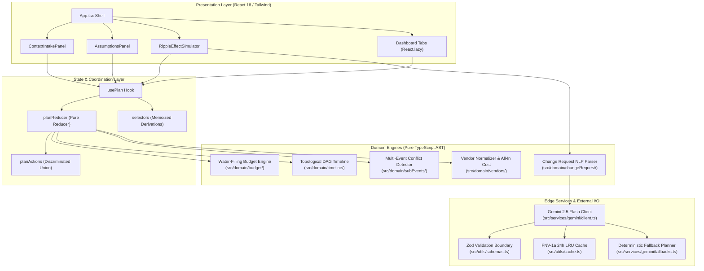

# UtsavAI System Architecture & Engineering Decision Records (ADRs)

## 1. System Topology & Unidirectional Data Flow

---

## 2. Architectural Decision Records (ADRs)

### ADR-001: Reducer Layering & Discriminated Unions
- **Context:** Complex celebration plans manage interrelated entities (budget line items, DAG tasks, vendor quotes, and multi-day sub-events). Scattering mutation logic across React component state causes inconsistent state resets during rapid inputs.
- **Decision:** All state transitions are unified in `src/state/planReducer.ts` governed by `PlanAction` discriminated unions (`LifecycleAction` and `DomainAction`). The compiler enforces exhaustive pattern matching (`const exhaustiveCheck: never = action`) to ensure 100% type-safe action dispatch.
- **Consequences:** Presentational components remain pure and prop-driven. Undo/redo, state persistence, and serialization become trivial. Every action is isolated and testable without DOM rendering.

### ADR-002: Water-Filling Budget Trade-Offs vs Simple Linear Scaling
- **Context:** When expenses overrun, naive systems scale down all budget categories uniformly (e.g. cutting 20% across venue, catering, and decor). In real Indian celebrations, essential categories (catering for elders, religious rituals) cannot absorb arbitrary cuts, and vendor contracts have hard minimum floors.
- **Decision:** UtsavAI implements an iterative **water-filling algorithm** (`src/domain/budget/tradeoffs.ts`). Categories are prioritized according to user ranking; non-essential categories absorb cuts proportionally until hitting minimum spend caps. If a category reaches its floor, the excess shortfall is automatically redistributed to remaining flexible categories. If total required savings exceed available non-essential capacity, the scenario explicitly flags `isFeasible: false` and calculates `requiredAdditionalFunds`.
- **Consequences:** Guaranteed mathematical budget invariant ($\sum \text{allocated} = \text{totalBudget} \pm 1\text{ INR}$). Verified quotes and protected user must-haves are safeguarded with zero reduction.

### ADR-003: Directed Acyclic Graph (DAG) for Timeline Delays
- **Context:** Celebration planning involves complex dependency chains. For example, caterer booking depends on venue locking and headcount confirmation; delay in venue finalization ripples down to invitations, catering tasting, and final rehearsal.
- **Decision:** Tasks are modeled as nodes in a DAG with directed dependency edges (`dependsOn`). Schedule propagation uses Kahn's topological sort algorithm (`src/domain/timeline/graph.ts`). Delays propagate via idempotent max-predecessor shifts (`src/domain/timeline/propagate.ts`). Cycles are rejected with descriptive error paths. Deadlines slipping past the event date trigger `isInfeasible: true` with calculated `minimumNoticeDays`.
- **Consequences:** Repeating delay recalculations is mathematically idempotent ($f(f(x)) = f(x)$). Critical path bottlenecks and ripple effects are calculated in $O(V + E)$ time.

### ADR-004: Hybrid Generative AI with AST Rule-Based Fallbacks
- **Context:** Reliance on external cloud APIs poses availability, latency, and cost risks. An event planner in the field must function even in offline or network-constrained settings.
- **Decision:** UtsavAI adopts a **deterministic-first hybrid architecture**. When Gemini 2.5 Flash is active with user BYOK credentials, prompts generate rich, creative natural language reasoning. If the network drops, rate limits trigger, or no API key is supplied, the system seamlessly executes pure deterministic TypeScript rule engines (`src/domain/changeRequest/parse.ts`, `src/services/gemini/fallbacks.ts`).
- **Consequences:** Zero application crashes. 100% functional testability in CI without API keys or network mocks. Zero vendor lock-in.
